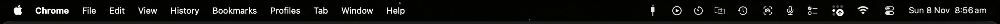

#  menu-bar-by-display

Keeps the menu bar on screen on a MacBook, and hides it again when you plug in a monitor

macOS 13 or later

<!-- media: hero -->

<!-- /media: hero -->

## What it is

I've been using my MacBook as my main screen lately, and on a laptop with a notch that strip at the top is dead space anyway. Even full screen windows stop below the notch, so having the menu bar auto-hide there just meant hovering up at the top for nothing.

On a big external monitor I do like it hidden though, and macOS only has the one setting for every screen. So this little background tool flips it for you: the menu bar is always shown when it's just the laptop screen, and goes back to auto-hiding as soon as a monitor is plugged in.

## Get it

Paste this into your AI coding agent (Claude Code, Codex, Cursor...):

> Fork https://github.com/mikecann/menu-bar-by-display to my GitHub account and
> clone my fork (if I don't use GitHub, or want to keep my copy private, just
> clone it instead), then make it my own. It's one of Mike Cann's personal tools,
> so read the README first, change anything specific to his setup to suit mine,
> then help me get it running.

### Or set it up by hand

You'll need macOS 13 or later, Git, and Xcode or Command Line Tools with Swift 5.10 or later. If the developer tools aren't installed, run `xcode-select --install` first. No API keys, `.env` file or permissions are needed.

```bash
git clone https://github.com/mikecann/menu-bar-by-display.git
cd menu-bar-by-display
bash install.sh
```

`install.sh` builds the tool, copies it to `~/.local/bin/menu-bar-by-display` and starts it at login as a LaunchAgent. You can pass another directory, for example `bash install.sh /path/to/bin`. Rerun it after changing the code to rebuild and restart it.

## Using it

There's nothing to click. Plug a monitor in or pull it out and the menu bar setting follows within a couple of seconds. To see what it thinks:

```console
$ menu-bar-by-display status
Displays:
  built-in 1512x982
Menu bar now: always shown
Menu bar wanted: always shown
```

`menu-bar-by-display apply` sets it once for the current displays and exits.

The rule is simple, and lives in `Sources/MenuBarByDisplayCore/Policy.swift` if you want a different one:

- Only the laptop's own screen on: the menu bar is never hidden, full screen included. This is "Never" under System Settings > Control Center > Automatically hide and show the menu bar.
- Any external display on, including with the lid shut: the menu bar auto-hides. This is "Always" in the same setting.

If you change that option in System Settings by hand, the tool sets it back the next time a display is plugged in or pulled out.

## How it works

It's one small Swift program that listens for display changes with `CGDisplayRegisterReconfigurationCallback`, and checks again after the Mac wakes. When the displays settle it writes the same two global settings System Settings does (`_HIHideMenuBar` and `AppleMenuBarVisibleInFullscreen`), then posts `AppleInterfaceMenuBarHidingChangedNotification` so the menu bar and windows move straight away with no logout. It doesn't touch anything when no displays are active, like mid-sleep. Changes are logged to `~/Library/Logs/menu-bar-by-display.log`.

## Development

```bash
swift test
bash Tests/install-tests.sh
bash install.sh
```

The Swift tests cover the display rule without touching real displays or settings. The install tests run the installer and uninstaller in a temp folder with a stub binary, so they don't build anything, start the LaunchAgent or change your menu bar.

## Removal

```bash
bash uninstall.sh
```

It stops the LaunchAgent and removes it and the command. The menu bar keeps whatever setting it had last, so change it in System Settings if you want it different. If you installed into a custom directory, pass that same directory to `uninstall.sh`.

## More tools

My other tools are at [mikerosoft.app](https://mikerosoft.app).

MIT licensed.
